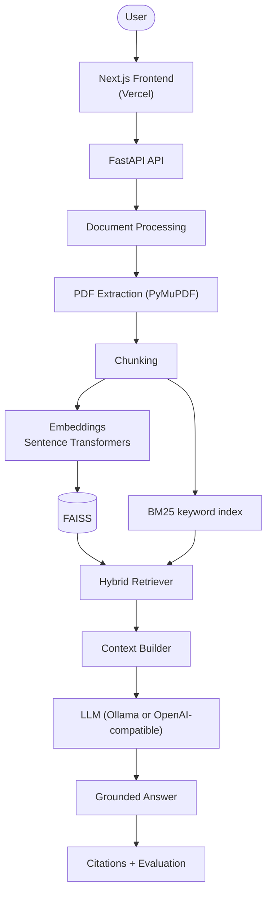

# Production-Grade RAG Document Assistant


Production-grade Retrieval-Augmented Generation platform for intelligent PDF question answering, combining FAISS
vector search and BM25 keyword retrieval with grounded LLM generation, source-level citations, and automated
hallucination evaluation. It runs entirely on free, open-source tools: no paid API is required.

## Contents

[Overview](#overview) · [Features](#features) · [Architecture](#architecture) · [Tech stack](#tech-stack) ·
[How RAG works](#how-rag-works-here) · [Hybrid search](#hybrid-search) · [Citations](#citation-system) ·
[Hallucination protection](#hallucination-protection) · [Evaluation](#evaluation-metrics) ·
[Structure](#project-structure) · [Installation](#installation) · [Environment variables](#environment-variables) ·
[Running](#running-locally) · [Ollama](#running-with-ollama) · [Tests](#running-tests) · [Docker](#docker-setup) ·
[Deployment](#deployment) · [Screenshots](#screenshots) · [API](#api-documentation) · [Demo](#sample-demo) ·
[Limitations](#known-limitations) · [Future work](#future-improvements) · [License](#license)

## Overview

Upload complex PDFs, ask questions in plain language, and get answers that are:

- **Grounded:** the model may only use retrieved passages, and refuses when evidence is missing.
- **Cited:** every answer links to the document, page and passage it came from.
- **Checked:** each answer is scored for faithfulness, invented numbers, relevance and citation coverage.

## Features

- Drag-and-drop PDF upload with validation, progress, and live processing status
- Page-aware text extraction and chunking (page numbers, document name and section kept for every chunk)
- Hybrid retrieval: FAISS semantic search plus BM25 keyword search with configurable weights
- Retrieval threshold: no strong evidence means no LLM call and an honest "insufficient evidence" reply
- Context-only prompting, validated `[Source N]` citations, clickable source cards
- Hallucination check (grounded true/false, confidence, unsupported sentences, invented numbers)
- Multi-document questions, conversation history, copy, regenerate and clear chat
- Dashboard, document management, evaluation dashboard, and a sample evaluation dataset
- Two interchangeable vector databases, FAISS and Chroma, with a built-in benchmark that compares them
- Free local LLM through Ollama; any OpenAI-compatible provider through environment variables
- FastAPI REST API with Swagger docs, SQLite, structured logging, automated tests, CI, Docker

## Architecture



More detail, including a request sequence diagram: [docs/ARCHITECTURE.md](docs/ARCHITECTURE.md).

## Tech stack

| Layer | Technology |
|---|---|
| Frontend | Next.js, React, TypeScript, Tailwind CSS, shadcn/ui, Lucide, React Markdown |
| Backend | Python 3.11, FastAPI, Pydantic, Uvicorn, SQLAlchemy, SQLite |
| Retrieval | Sentence Transformers (`all-MiniLM-L6-v2`), FAISS or Chroma (switchable), BM25 (`rank-bm25`), LangChain text splitter |
| PDF | PyMuPDF |
| LLM | Ollama (default), or any OpenAI-compatible API |
| Quality | pytest, GitHub Actions, Docker Compose |

## How RAG works here

1. **Ingest:** a PDF is split into pages, cleaned, and cut into overlapping chunks (default 800 characters, 150 overlap) that keep their page number.
2. **Index:** each chunk is embedded once (in batches) into FAISS and also added to a BM25 keyword index.
3. **Retrieve:** a question runs through both indexes and the results are fused (see below).
4. **Generate:** the top chunks go to the LLM in a prompt that allows only the supplied context.
5. **Verify:** citations are validated and the answer is compared with the retrieved text.

## Hybrid search

Dense vectors find paraphrases ("revenue growth" matches "sales increased"); BM25 finds exact names, codes and
numbers. For each question both retrievers return candidates, each score list is min-max normalised to 0..1, and
the final score is

    score = 0.7 x dense + 0.3 x BM25      (DENSE_WEIGHT and BM25_WEIGHT in .env)

The raw cosine similarity is kept separately because it, not the relative fused score, decides whether the
evidence is strong enough to answer (`RETRIEVAL_THRESHOLD`).

## Vector databases: FAISS and Chroma

Embeddings are stored in FAISS by default (exact flat search). Chroma, a free vector database that uses an
approximate HNSW index and filters by document inside the database, is available as a second backend:

    pip install -r backend/requirements-chroma.txt
    # set VECTOR_STORE=chroma in backend/.env, then fill it from the saved chunks:
    python -m app.scripts.reindex

`python evaluation/compare_vector_stores.py` measures both on the same vectors (build time, disk size, query
latency, filtered queries, recall against exact search) and the results appear on the Evaluation page. Details and
how to read the numbers: [docs/VECTOR_STORES.md](docs/VECTOR_STORES.md).

## Citation system

The model cites with `[Source N]`. The backend checks every number against the passages that were actually
supplied, removes invented ones, rewrites valid ones to `[Source: Annual_Report.pdf, Page 42]`, and returns only
the cited passages with document, page, snippet, similarity and retrieval type. The UI turns each marker into a
chip that opens the full passage. Citation coverage (share of factual sentences with a valid citation) is measured.

## Hallucination protection

1. Context-only prompt with explicit refusal wording
2. Retrieval threshold (weak evidence means no LLM call)
3. Citation validation and coverage
4. Grounding check per sentence: word overlap with the context, semantic similarity to the best-matching passage,
   and a strict check that every number also appears in the context
5. Optional `BLOCK_UNGROUNDED=true` replaces unsupported answers with "insufficient evidence"

This is a **fast heuristic, not a proof**. It catches invented facts, wrong numbers and off-topic answers, and can
miss subtle reasoning errors.

## Evaluation metrics

Tracked per answer: faithfulness, answer relevance, context relevance, citation coverage, latency, grounded vs
potentially hallucinated. The evaluation dashboard separates:

- **Live usage:** scores from your own chats.
- **Sample Evaluation:** 22 questions (factual, numerical, multi-hop, comparison, unanswerable) about three
  *fictional* documents in `evaluation/`, adding retrieval precision and recall, answer match and correct refusals.

These scores are heuristics on a small synthetic dataset. They are a sanity check for the pipeline, **not benchmark
results**, and this repository does not publish any numbers. Run it yourself:
`python evaluation/evaluate.py --ingest`.

## Project structure

```
rag-document-assistant/
├── backend/
│   ├── app/
│   │   ├── api/        documents, chat, search, conversations, dashboard, evaluation
│   │   ├── core/       logging
│   │   ├── models/     SQLAlchemy models, Pydantic schemas
│   │   ├── rag/        processor, chunker, embeddings, FAISS + Chroma stores, BM25, hybrid, prompt, generator, citation, evaluator
│   │   ├── services/   document, chat, evaluation, dashboard
│   │   ├── config.py   all settings (environment variables)
│   │   └── main.py
│   ├── tests/          pytest suite (offline, no model download)
│   ├── requirements.txt / requirements-dev.txt
│   └── Dockerfile
├── frontend/           Next.js app (app/, components/, hooks/, lib/, types/)
├── evaluation/         questions.json, evaluate.py, make_sample_pdfs.py, results.json
├── deploy/             HTTPS proxy files for a public server
├── docs/               ARCHITECTURE.md, DEPLOYMENT.md, VECTOR_STORES.md, PORTFOLIO.md, RELEASE_CHECKLIST.md
├── docker-compose.yml
└── .env.example
```

## Installation

You need Python 3.11 or newer, Node.js 22 or newer, and (for the default LLM) [Ollama](https://ollama.com).

    git clone https://github.com/your-username/rag-document-assistant.git
    cd rag-document-assistant

**Backend** (from `backend/`):

    python -m venv .venv
    .venv\Scripts\activate                # macOS/Linux: source .venv/bin/activate
    pip install -r requirements.txt
    copy ..\.env.example .env             # macOS/Linux: cp ../.env.example .env

The first install is large (PyTorch). To save disk space, run
`pip install torch --index-url https://download.pytorch.org/whl/cpu` first.

**Frontend** (from `frontend/`):

    npm install
    copy .env.local.example .env.local    # macOS/Linux: cp .env.local.example .env.local

## Environment variables

Copy `.env.example` to `backend/.env`. Never commit `.env`.

| Variable | Default | Meaning |
|---|---|---|
| `LLM_PROVIDER` | `ollama` | `ollama` or `openai` (any OpenAI-compatible API) |
| `OLLAMA_BASE_URL` / `OLLAMA_MODEL` | `http://localhost:11434` / `llama3.2` | Local LLM |
| `OPENAI_BASE_URL` / `OPENAI_API_KEY` / `OPENAI_MODEL` | | Optional hosted provider (key stays on the backend) |
| `EMBEDDING_MODEL` | `sentence-transformers/all-MiniLM-L6-v2` | Embedding model |
| `VECTOR_STORE` | `faiss` | `faiss` or `chroma` (needs `requirements-chroma.txt`) |
| `CHUNK_SIZE` / `CHUNK_OVERLAP` | `800` / `150` | Chunking |
| `TOP_K` | `5` | Passages per question |
| `DENSE_WEIGHT` / `BM25_WEIGHT` | `0.7` / `0.3` | Hybrid fusion weights |
| `RETRIEVAL_THRESHOLD` | `0.35` | Minimum cosine similarity needed to answer |
| `GROUNDING_SUPPORT_THRESHOLD` / `GROUNDING_MIN_FAITHFULNESS` | `0.5` / `0.8` | Hallucination check strictness |
| `BLOCK_UNGROUNDED` | `false` | Replace unsupported answers |
| `MAX_UPLOAD_MB` | `25` | Upload size limit |
| `DATABASE_URL` | `sqlite:///./rag.db` | Database |
| `CORS_ORIGINS` | `http://localhost:3000` | Allowed frontend addresses |
| `SECRET_KEY` | `change-this-secret` | Set a random value in production |
| `NEXT_PUBLIC_API_URL` | `http://localhost:8000` | Backend address (frontend `.env.local`) |

## Running locally

Terminal 1 (backend, from `backend/`):

    uvicorn app.main:app --reload

Terminal 2 (frontend, from `frontend/`):

    npm run dev

Open http://localhost:3000 (app) and http://localhost:8000/docs (API docs).

## Running with Ollama

    ollama pull llama3.2          # one-time download
    ollama serve                  # only if Ollama is not already running in the background

Other models work too: set `OLLAMA_MODEL` to `qwen2.5` or `mistral`. Prefer a hosted LLM instead? See
`OPENAI_*` above.

## Running tests

From `backend/`:

    pip install -r requirements-dev.txt
    pytest
    pytest --cov=app --cov-report=term-missing

The suite runs offline and quickly: it uses a fake embedder and fake LLMs. Details: `backend/tests/README.md`.

## Docker setup

    cp .env.example .env
    docker compose up --build

Frontend on port 3000, API on port 8000. Optional bundled Ollama: `docker compose --profile ollama up --build`.
Full guide and troubleshooting: [DOCKER.md](DOCKER.md).

## Deployment

The frontend deploys to **Vercel**; the backend needs a host with a persistent disk and a few GB of RAM.
Step-by-step instructions, an honest comparison of free tiers, and the limits of each (persistent filesystem,
FAISS indexes, model storage, CPU and RAM, timeouts, cold starts) are in
[docs/DEPLOYMENT.md](docs/DEPLOYMENT.md).

Short version:

1. Push to GitHub.
2. Import the repository into Vercel with **Root Directory = `frontend`**.
3. Set `NEXT_PUBLIC_API_URL` to your backend's HTTPS address, then deploy.
4. Deploy the backend separately (for example an Oracle Cloud Always Free VM with `docker compose`).
5. Add the Vercel address to the backend's `CORS_ORIGINS`.

Do not run Ollama inside Vercel. There is no login yet, so keep a public backend URL private.

## Screenshots

Add your own captures to `docs/screenshots/` before publishing:

| Page | File |
|---|---|
| Landing | `docs/screenshots/landing.png` |
| Dashboard | `docs/screenshots/dashboard.png` |
| Documents | `docs/screenshots/documents.png` |
| Chat with citations | `docs/screenshots/chat.png` |
| Evaluation | `docs/screenshots/evaluation.png` |


## API documentation

Interactive Swagger UI at `/docs`, ReDoc at `/redoc`.

| Method | Path | Purpose |
|---|---|---|
| POST | `/api/documents/upload` | Upload a PDF (validated, processed in the background) |
| GET | `/api/documents`, `/api/documents/{id}` | List or fetch documents |
| GET | `/api/documents/{id}/chunks` | Extracted chunks (`page`, `limit`, `offset`) |
| DELETE | `/api/documents/{id}` | Delete a document and its index entries |
| POST | `/api/search` | Dense, BM25 or hybrid retrieval only |
| POST | `/api/chat` | Ask a question (`regenerate` supported) |
| GET / DELETE | `/api/conversations`, `/api/conversations/{id}` | Chat history |
| POST | `/api/evaluate` | Start the sample evaluation (background) |
| GET | `/api/evaluation/status`, `/metrics`, `/results` | Evaluation progress and scores |
| GET | `/api/evaluation/vector-stores` | Last FAISS vs Chroma benchmark |
| GET | `/api/dashboard/stats`, `/api/config`, `/api/health` | Dashboard, read-only settings, health |

Chat response (shortened):

```json
{
  "answer": "Revenue increased by 18 percent. [Source: Annual_Report.pdf, Page 2]",
  "grounded": true,
  "confidence": 0.91,
  "citations": [
    {"document": "Annual_Report.pdf", "page": 2, "chunk_id": "...", "text": "...", "score": 0.89, "retrieval_type": "hybrid"}
  ],
  "metrics": {"retrieval_time_ms": 120, "generation_time_ms": 850, "total_time_ms": 970}
}
```

## Sample demo

With no documents the app shows **"Upload a PDF to start asking questions."** and five sample questions.

To try it with the bundled fictional documents:

    python evaluation/make_sample_pdfs.py

then upload the three PDFs from `evaluation/sample_docs/` on the Documents page and ask:

| Question | Expected answer |
|---|---|
| What was the revenue in FY2025? | USD 84.6 million |
| By what percentage did revenue grow in FY2025? | 18 percent |
| What were the major revenue sources? | Cloud subscriptions 58%, professional services 27%, licence fees 15% |
| Compare the revenue figures in the annual report and the financial statement. | Both say USD 84.6 million |
| Who is the chief executive officer? | Not in the documents (the assistant should decline) |

You can also use any public-domain PDF (for example a book from Project Gutenberg, or a government report). Check
each document's licence before you redistribute it.

## Known limitations

- Scanned PDFs (images only) are not supported; there is no OCR.
- No authentication yet: do not expose a backend publicly with sensitive documents.
- The FAISS index is in memory in one process (flat index, fine for thousands of chunks, not millions). Chroma is the alternative; neither is a multi-server setup.
- The hallucination check is heuristic. Evaluation scores come from a small synthetic dataset.
- Answers are not streamed token by token; the UI shows a loading state instead.
- After running the evaluation CLI while the server is up, restart the server so it loads the new index.

## Future improvements

JWT authentication with per-user documents, OCR for scanned PDFs, streaming answers, a re-ranking model,
PostgreSQL and a managed vector database for multi-instance hosting, richer evaluation (LLM-as-judge, human labels),
and frontend tests.

## License

MIT. See [LICENSE](LICENSE).
