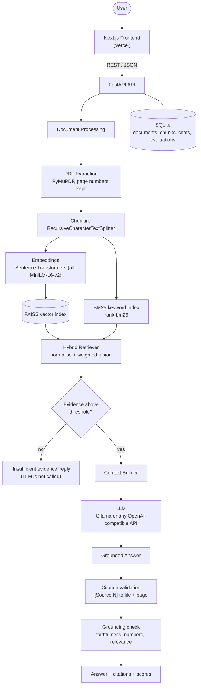
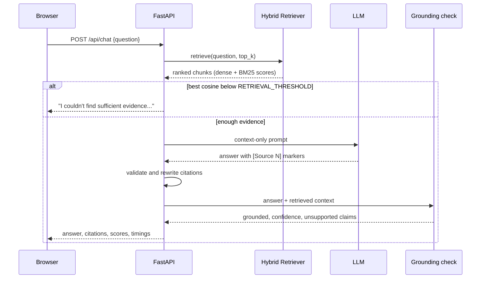

# Architecture

## System overview

## One chat request

## Where the code lives

| Stage | File |
|---|---|
| PDF text and headings | `backend/app/rag/document_processor.py` |
| Chunking | `backend/app/rag/chunker.py` |
| Embeddings | `backend/app/rag/embeddings.py` |
| FAISS store | `backend/app/rag/vector_store.py` |
| BM25 | `backend/app/rag/bm25_retriever.py` |
| Hybrid fusion | `backend/app/rag/hybrid_retriever.py` |
| Context and prompt | `backend/app/rag/context_builder.py`, `prompt.py` |
| LLM clients | `backend/app/rag/generator.py` |
| Citations | `backend/app/rag/citation.py` |
| Hallucination check | `backend/app/rag/evaluator.py` |
| Chat orchestration | `backend/app/services/chat_service.py` |
| Evaluation runs | `backend/app/services/evaluation_service.py`, `evaluation/` |
